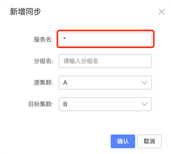
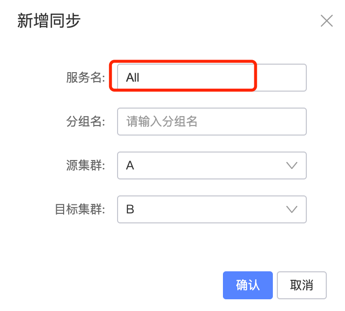

# Nacos Sync

[English](README.md) | 简体中文

Nacos Sync 是一个在不同注册中心之间同步服务注册信息的工具，用于帮助用户从一个注册中心迁移到另一个注册中心。

## [示例](https://github.com/paderlol/nacos-sync-example/tree/2.0)

nacos-sync 2.x 的示例在 nacos-sync-example 的 `2.0` 分支上，`master` 分支是 0.x 的示例。

## 升级

从 0.5.0 升级到 2.0、迁移到 Nacos 3.x 以及版本兼容性，见 [UPGRADE.zh-CN.md](UPGRADE.zh-CN.md)（[English](UPGRADE.md)）。

## 测试

- 单元测试：`mvn test`
- 在 Docker 中对接真实注册中心的集成测试（Testcontainers）：`mvn -Pit verify -pl nacossync-test -am`
- 使用示例应用的端到端测试，包括跨版本的 Nacos 到 Nacos 同步、Spring Cloud 各版本系列下的 Eureka 和从上一个
  发布版升级：见 [e2e/README.zh-CN.md](e2e/README.zh-CN.md)

## 功能

- Console：提供管理用的 API 和控制台
- Worker：负责服务注册信息的同步

## 架构

### 架构拓扑

```
            +-------------+
     +----> |NacosClusterA|
     |      +-------------+               +-------------+
     |                                    |NacosClusterB|
Pull |                                    +--+----------+
Info |      +------------+                   ^
     |      |ZooKeeper   |                   |
     |      +--+---------+                   | Push Info
     |         ^ Pull Info                   |
     |         |                             |
     |        ++-----------------------------+--+
     <--------+  NacosSync1, NacosSync2,....    |
              +---+-------------------------+---+
                  |                         |
                  |                         |
                  |                         |
                  |       +---------+       |
                  +-----> |NacosSync| <-----+
                          |Database |
                          +---------+
```

### 架构要点

- 所有注册信息都保存在 NacosSync 的数据库中。
- 多个 NacosSync 实例执行相同的任务。
    - 多个 NacosSync 实例保证高可用。
    - 多个实例执行相同的任务，让架构保持简单。
    - 目标 Nacos 集群会对来自 Nacos 的同步信息去重。

## 快速开始

- Swagger API：http://127.0.0.1:8083/swagger-ui.html#/
- Web 控制台：http://127.0.0.1:8083/
- 其他：待补充

# NacosSync 迁移用户指南

## 支持的迁移类型

| 源 | 目标 | 是否支持 | 说明 |
|-----------|-----------|---------|------|
| Nacos     | Nacos     | 是      | Nacos 2.x 和 3.x，已在 2.5.4 和 3.2.4 上测试，包括两个版本之间的双向同步 |
| Nacos     | Zookeeper | 是      | 仅支持 **Dubbo** 的注册中心 |
| Nacos     | Consul    | 是      | 仅支持 **Spring Cloud** 的注册中心 |
| Nacos     | Eureka    | 是      | 仅支持 **Spring Cloud** 的注册中心 |
| Zookeeper | Nacos     | 是      | 仅支持 **Dubbo** 的注册中心 |
| Consul    | Nacos     | 是      | 仅支持 **Spring Cloud** 的注册中心 |
| Eureka    | Nacos     | 是      | 仅支持 **Spring Cloud** 的注册中心 |

## 框架版本

| 框架               | 版本       |
|------------------|----------|
| Java Jdk         | 17       |
| Spring Boot      | 3.4.0    |
| Spring Cloud     | 2024.0.0 |
| Nacos Client     | 3.2.4    |
| Zookeeper Client | 3.7.2    |
| Consul Client    | 1.4.5    |
| Eureka Client    | 2.0.4    |

## 本手册的目标

- 启动 NacosSync 服务
- 通过一个简单的示例，演示如何把注册在 Zookeeper 注册中心的 Dubbo 客户端迁移到 Nacos 注册中心

## 前置条件

开始之前，请先安装：

- 64 位操作系统：支持 Linux/Unix/Mac/Windows，推荐 Linux/Unix/Mac。
- 64 位 JDK 17+：下载并设置 JAVA_HOME。
- Maven 3.5.2+：[下载](https://maven.apache.org/download.cgi)，[配置](https://maven.apache.org/settings.html)。
- MySQL 8（已用 8.4 测试）

## 下载并构建

获取 NacosSync 有两种方式：

- 下载运行包
- 从 Github 下载源码自行构建

``` xml

cd nacos-sync/
mvn clean package -U

```

构建产物的路径：

``` xml

nacos-sync/nacossync-distribution/target/nacos-sync-2.0.0.tar.gz

```

解压安装包后的目录结构：

``` xml

nacos-sync
├── LICENSE
├── NOTICE
├── bin
│   ├── nacosSync.sql
│   ├── shutdown.sh
│   └── startup.sh
├── conf
│   ├── application.properties
│   └── logback-spring.xml
├── logs
└── nacos-sync-server.jar

```

## 初始化数据库

默认使用 MySQL 数据库，也可以支持其他关系型数据库。

- 创建数据库，默认库名为 nacos_sync。
- 不需要单独建表，Hibernate 会自动建表。
- 如果自动建表失败，可以用 bin 目录下的 nacosSync.sql 建表。

## 数据库配置

在 conf 目录下的 application.properties 中：

``` xml

spring.datasource.url=jdbc:mysql://127.0.0.1:3306/nacos_sync?characterEncoding=utf8
spring.datasource.username=root
spring.datasource.password=root

```

## 启动服务

``` xml

$ nacosSync/bin:
sh startup.sh  start

```

## 管理控制台

``` xml

http://127.0.0.1:8083/#/serviceSync

```

## 高级配置

### 从 Zookeeper 全量同步到 Nacos（Dubbo）

在表单的“Service Name”字段中填写“*”时，会把 Zookeeper 中的所有服务全量同步到 Nacos，仅适用于 Dubbo。



### 从 Nacos 全量同步到 Nacos

在表单的“Service Name”字段中填写“All”时，会自动同步当前集群**默认分组**下的所有服务。


